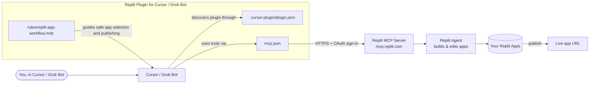

# Architecture

Intended integration flow for Cursor / Grok Bot. Grok Bot distribution and end-to-end behavior remain to be confirmed with the partner team.

## The pieces

- **You, in Cursor / Grok Bot** — you describe what you want in the client's chat.
- **Cursor / Grok Bot** — the client assistant that uses Replit's MCP tools.
- **plugin.json** — the plugin's ID card (name, version, description). Cursor uses it to recognize the plugin.
- **mcp.json** — tells Cursor where Replit's server lives. No keys stored here.
- **replit-app-workflow.mdc** — Cursor guidance to identify the intended app before editing and ask for confirmation before publishing.
- **Replit MCP Server** — Replit's online service that accepts requests from AI tools. You sign in once through your browser.
- **Replit Agent** — Replit's own AI that actually writes and changes the app code.
- **Your Replit Apps** — the apps in your Replit account.
- **Live app URL** — the public link you get after publishing.

This repository packages the plugin manifest, remote MCP configuration, and a
Cursor rule. Authentication and app operations are handled by the existing
Replit service, not code in this plugin.
